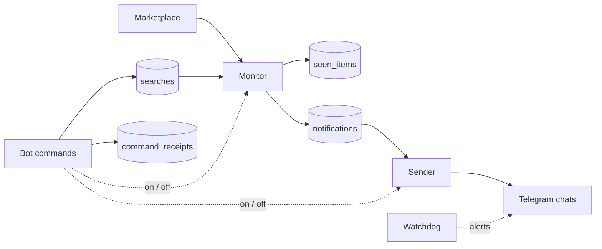

# n8n Marketplace Monitor

A self-hosted monitor for online marketplace searches, built entirely on [n8n](https://n8n.io). It polls saved searches, detects new listings and delivers them to Telegram as photo cards. Searches are managed from a Telegram bot.

The system runs on a small VPS with Docker Compose and Caddy. This repository contains the workflows, table schema and deployment configuration, with no credentials, data or instance-specific settings.

## Features

- **Search monitoring:** shared polling loop over up to 15 searches, three requests at a time. Data is parsed from the page JSON with an HTML fallback, and new items are written in batches.
- **Silent baseline:** the first check of a new search remembers up to five pages of existing items without notifying, so only items listed later are sent.
- **Reliable delivery:** a queue in a data table with per-recipient confirmation (Telegram `message_id`). Retries go only to recipients who did not get the card, and a card is dropped after three failed attempts.
- **Rate-limit handling:** on HTTP 429 the cycle stops, keeps the results it already has and resumes from the first unprocessed search after a pause.
- **Telegram bot control:** `/add`, `/del`, `/list`, `/status`, `/interval`, `/on`, `/off`, `/perf` and `/history` (charts). Access is limited to an allow-list of private chats, and every command is logged with its response.
- **Single-owner locking without extra infrastructure:** a conditional update in a state table stops two executions of the same role from processing data at once.
- **Watchdog:** a separate workflow checks for failed executions, a monitoring cycle that has stopped completing, searches without recent successful checks and loss of access to the n8n API, then alerts the admin.
- **Housekeeping:** nightly and weekly cleanup keeps history and sent cards bounded.
- **Observability:** n8n Prometheus metrics (loopback only) feed `/perf`, and sampled metrics feed `/history`.

## Architecture



| Workflow | Purpose |
|---|---|
| `workflows/marketplace-monitor.json` | Polling cycle, new-item detection, queueing, cleanup |
| `workflows/telegram-notifications.json` | Delivers queued cards and records the result for each recipient |
| `workflows/telegram-commands.json` | Bot commands: access check, execution, logging |
| `workflows/watchdog.json` | Health checks every 5 minutes and alerts to the admin |

State is kept in six n8n Data Tables (`schemas/data-tables.json`). There is no external database, queue or Redis: n8n with SQLite in a Docker volume is the whole backend.

## Stack

n8n 2.x (Code nodes in JavaScript, Data Tables, n8n public API), Telegram Bot API, Docker Compose, Caddy (automatic HTTPS), Node.js for the install script.

## Repository layout

```
workflows/   n8n workflows, exported inactive and without credentials
schemas/     Data Table definitions (columns only)
scripts/     install-instance.cjs: creates the tables and workflows in an empty n8n via its API
deploy/      compose.yaml, Caddyfile, .env.example
config/      example search definitions
docs/        bot user guide
```

## Deployment outline

1. Set the domain in `deploy/.env` (see `.env.example`) and run `docker compose --profile public up -d` in `deploy/`.
2. In n8n, create the owner account, an API key and a Telegram credential for the bot.
3. Run `scripts/install-instance.cjs` with the instance URL, the API key file and the allowed chat IDs. It creates the tables, imports the workflows, attaches credentials and activates the bot.
4. Send `/start` to the bot and add searches with `/add`. See [docs/user-guide.md](docs/user-guide.md).
